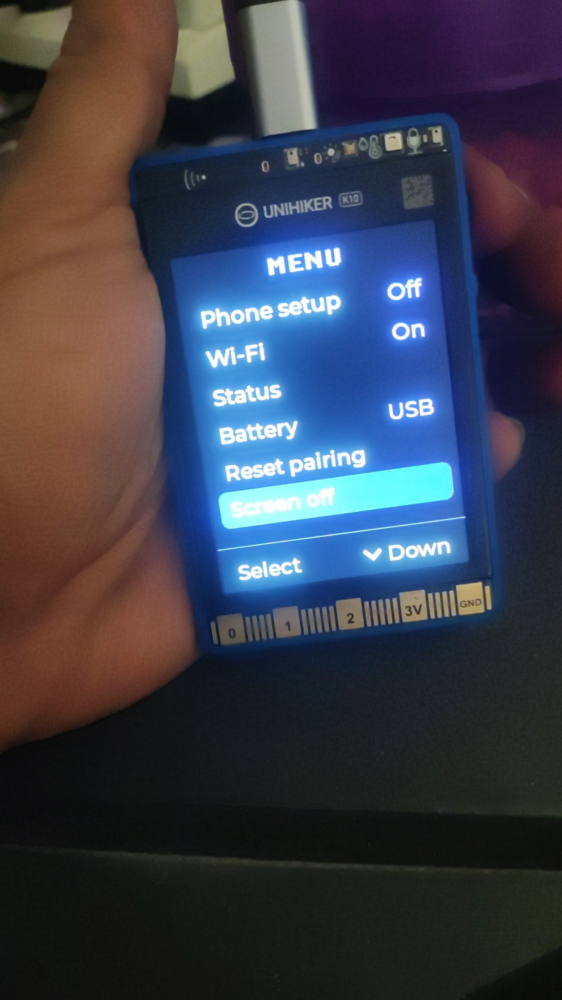
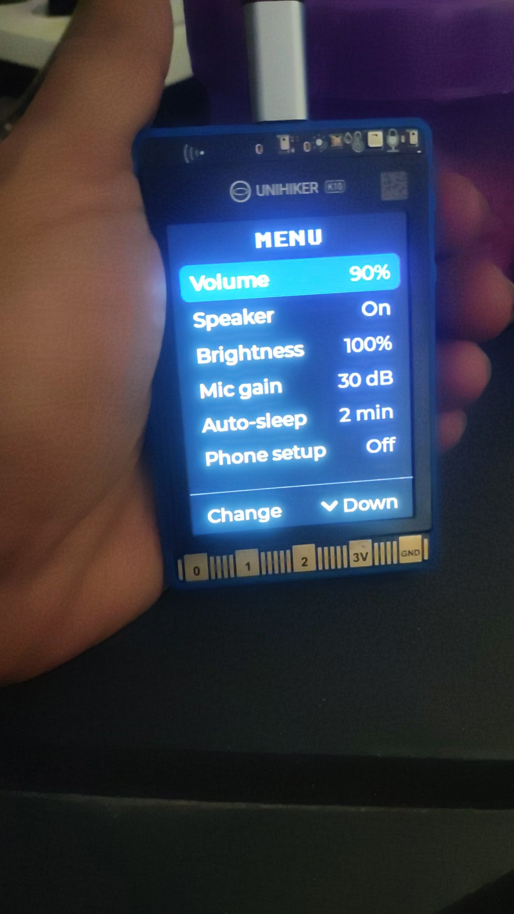
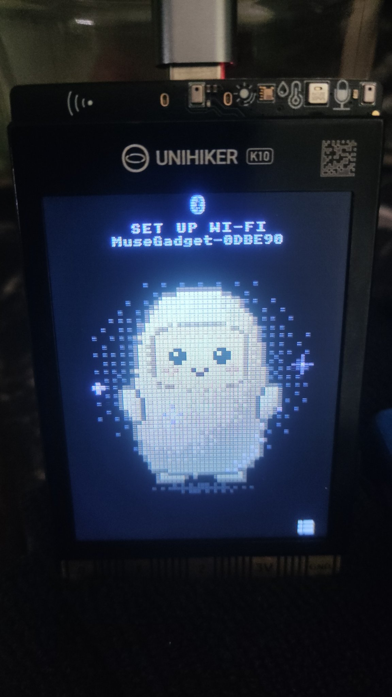

# UNIHIKER K10 sebagai Muse Gadget (df-k10)

Port native board **DFRobot UNIHIKER K10** ke [muse-gadget-sdk](https://github.com/facebookincubator/muse-gadget-sdk).
README ini menggantikan README generik upstream — isinya spesifik board df-k10: pin mapping,
hasil bring-up, dan foto hardware asli.

> **Status (2026-10-06): stage-1 bring-up SELESAI & terverifikasi hardware.**
> Eksperimen saat ini PAUSED — daily driver = firmware k10-genius.
> Repo ini disimpan sebagai referensi port + donor LCD/UI.

## Foto hardware


*Menu sistem: Phone setup, Wi-Fi, Status, Battery, Reset pairing, Screen off*


*Menu audio & daya: Volume 90%, Speaker On, Brightness 100%, Mic gain 30 dB, Auto-sleep 2 min*


*Layar SET UP WI-FI — BLE advertise sebagai `MuseGadget-0DBE90`*

## Spesifikasi board

| Item | Nilai |
|---|---|
| Board | DFRobot UNIHIKER K10 |
| Chip | ESP32-S3N16R8 (16 MB flash, 8 MB **octal** PSRAM) |
| LCD | ILI9341 240×320, SPI3 (MOSI 21, SCLK 12, CS 14, DC 13, RST NC) |
| Backlight | TCA9555 I/O expander @0x20 (I2C1), pin P0 — **ON/OFF saja** (tanpa PWM) |
| I2C | I2C_NUM_1: SDA 47, SCL 48 |
| I2S | I2S0: MCLK 3, BCLK 0, WS 38, DOUT 45, DIN 39 — 16 kHz / 16-bit |
| Speaker | `esp_codec_dev`, raw I2S TX — ES8311 **tidak** di-init via I2C (tidak menjawab @0x18) |
| Mic | ES7210 @0x23, RX TDM mode |
| Tombol A / B | Expander pin P0.2 / P1.4, active-low (A = PTT / talk button) |
| Firmware | `muse-gadget.bin` ±2052 KB — muat nyaman di flash 16 MB |

## Yang sudah dicapai (stage-1, [HW] terverifikasi)

- ✅ Boot stabil — PSRAM 8 MB octal terdeteksi
- ✅ LCD ILI9341 tampil — menu sistem + layar Wi-Fi setup (lihat foto)
- ✅ BLE pairing — terdeteksi sebagai `MuseGadget-0DBE90`
- ✅ Wi-Fi scan & connect OK
- ✅ Voice pipeline (mic → Muse → speaker) jalan
- ✅ Percakapan native Muse 1 putaran OK
- ✅ Local TTS (`CONFIG_MUSE_LOCAL_TTS`) — suara `id-ID-GadisNeural` via server LAN
- ✅ Build bersih, zero warnings (ESP-IDF v6.0.1) — commit `4b63dc5`

## Keterbatasan yang diketahui

- 📷 **Kamera dinonaktifkan** (`#if 0`) — DMA kamera VGA (~30 KB) membuat LVGL display
  buffer (15 KB) kelaparan → bootloop. Butuh redesign alokasi DMA, di luar scope stage-1.
- 🗣️ **STT Bahasa Indonesia belum** — `/chat/stream` tidak mengirim language field
  (SDK issue #164, masih OPEN di upstream); Azure ditolak (tanpa kartu kredit);
  self-host Whisper ditolak (server kekecilan).
- 💡 Backlight hanya ON/OFF — keterbatasan hardware, bukan bug.
- 🔋 Tidak ada ADC baterai di board ini.

## Build & flash

Workspace: `D:\ESP-PROJECTS\ACTIVE\k10-muse` · Toolchain: ESP-IDF v6.0.1

```bat
build_k10.bat
```

atau manual:

```sh
idf.py -B build-muse-unihiker-k10 -DIDF_TARGET=esp32s3 \
  -DSDKCONFIG=build-muse-unihiker-k10/sdkconfig \
  -DSDKCONFIG_DEFAULTS="sdkconfig.defaults;devices/sdkconfig.muse;devices/sdkconfig.muse-unihiker-k10" \
  build
idf.py -B build-muse-unihiker-k10 -p COM14 flash
```

> Ganti `COM14` dengan port K10 masing-masing.
> Jangan tekan/hold tombol BOOT (GPIO0) saat operasi normal — pin ini = I2S BCLK.

## File yang ditambahkan untuk board ini

| File | Isi |
|---|---|
| `esp32/components/muse/boards/board_unihiker_k10.c` | Implementasi `muse_board_t` (init, display, audio, tombol via expander) |
| `esp32/devices/sdkconfig.muse-unihiker-k10` | Overlay: esp32s3, board select, flash 16 MB, octal PSRAM |
| `docs/img/` | Foto hardware (asli, tanpa edit) |

## Referensi

- Upstream SDK: [facebookincubator/muse-gadget-sdk](https://github.com/facebookincubator/muse-gadget-sdk)
- SDK token & pairing: lihat README upstream (setiap gadget butuh token untuk pair)
